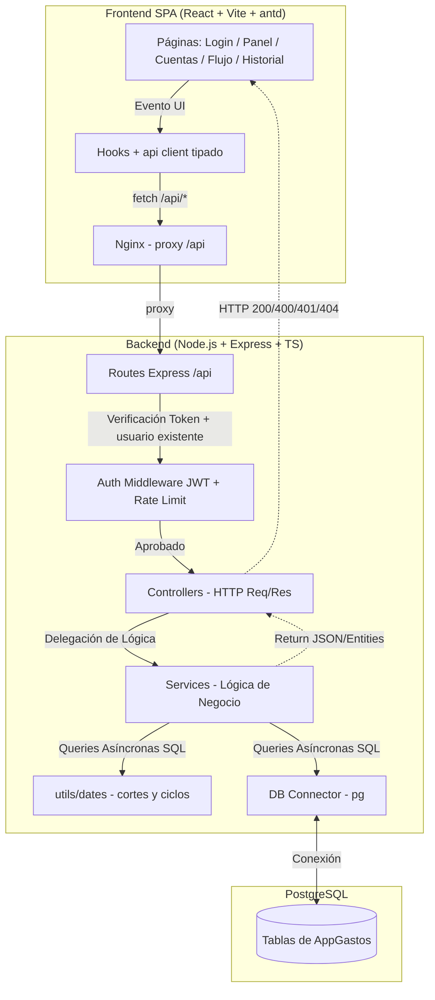
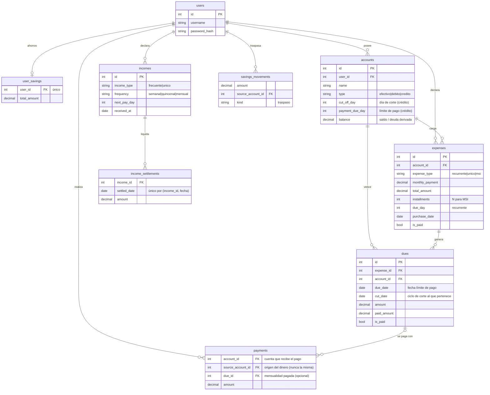
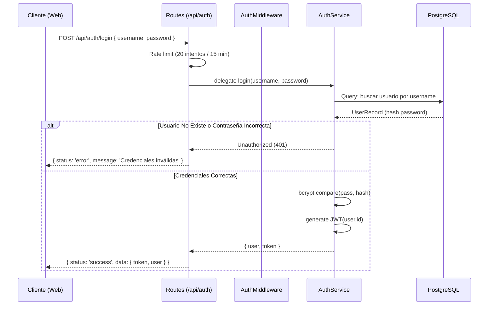
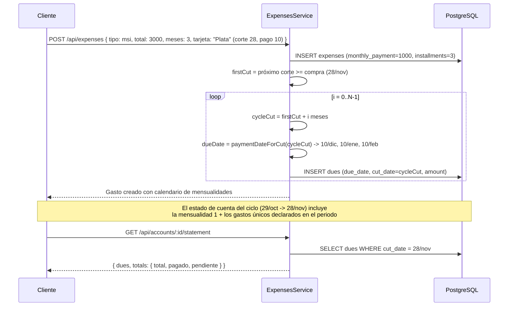
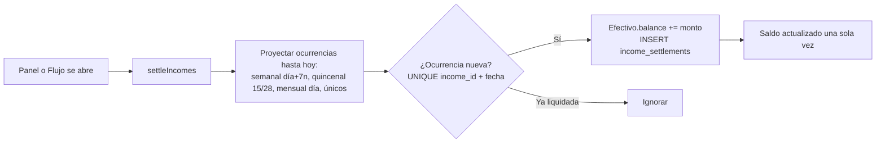
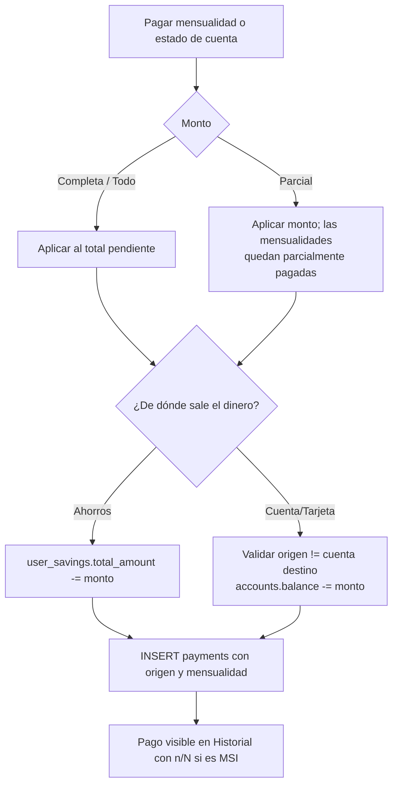
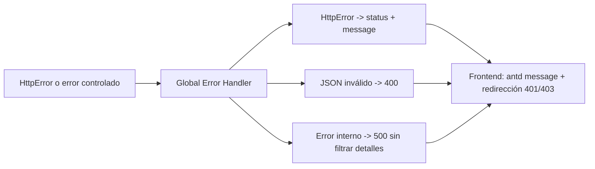

# Arquitectura y Diagramas de Flujo - AppGastos

Este documento ilustra la arquitectura técnica y los flujos de datos operativos dentro del ecosistema de **AppGastos** (v2: cuentas, tarjetas de crédito, MSI y estados de cuenta), basándose en las regulaciones de la carpeta `.agent/skills/`.

## 1. Diagrama de Arquitectura de Alto Nivel

El sistema sigue una arquitectura estricta Cliente-Servidor. El cliente (SPA React) envía peticiones REST JSON al Backend (Express.js, rutas bajo `/api`), el cual procesa esa petición a través de enrutadores, controladores y luego la pasa a la capa de servicios para interactuar con la Base de Datos.



## 2. Modelo de Datos (Esquema v2)

Migraciones en `backend/src/db/migrations/` (`001` a `004`), aplicadas automáticamente al crear el volumen de Docker.



### Reglas de negocio clave

1. **Tarjetas de crédito**: `cut_off_day` cierra el estado de cuenta; `payment_due_day` es la fecha límite de pago. Ambos entre 1 y 28.
2. **Ciclo de un estado de cuenta**: ventana `(corte anterior, próximo corte]`. Las mensualidades se agrupan por `dues.cut_date`, no por su fecha de vencimiento.
3. **Fecha límite de pago de un ciclo**: si `payment_due_day > cut_off_day` cae en el mismo mes del corte; si es anterior o igual, al mes siguiente (ej.: corte 28, pago 10 → el ciclo que cierra 28/nov se paga el 10/dic). Implementado en `utils/dates.ts → paymentDateForCut()`.
4. **MSI**: N mensualidades, una por ciclo de corte desde el corte siguiente a la compra; cuota fija y la última absorbe el redondeo.
5. **Recurrentes**: generan 12 mensualidades rodantes (`ensureRecurringDues`, `ON CONFLICT DO NOTHING`), extendidas perezosamente al consultar calendario/flujo/panel.
6. **Deuda de tarjeta**: derivada, no almacenada: `SUM(amount - paid_amount)` de sus mensualidades no pagadas.
7. **Quincena fija**: los ingresos quincenales proyectan los días **15 y 28** de cada mes (febrero recorta al 28).
8. **Liquidación de ingresos** (`IncomesService.settleIncomes`): cada ocurrencia vencida se acredita **una sola vez** a la cuenta Efectivo; la idempotencia la garantiza `income_settlements (UNIQUE income_id + settled_date)`. Ninguna ocurrencia es anterior a la creación del ingreso.
9. **Fuentes de pago**: ahorros o cualquier cuenta/tarjeta **distinta** a la que recibe el pago. Pagar una tarjeta consigo misma devuelve 400.
10. **Ahorros**: independientes de las cuentas; se alimentan por traspaso (`savings_movements`) o se definen manualmente.

## 3. Flujo de Autenticación de Usuario (Login)



> El registro crea además la fila de **ahorros** y la cuenta **Efectivo** del usuario.
> El middleware verifica que el usuario del JWT **exista** en cada petición: si fue
> eliminado (p. ej. tras un reset de BD) responde 401 y el frontend cierra sesión.

## 4. Flujo: Compra a meses (MSI) y Estado de Cuenta



## 5. Flujo: Liquidación automática de ingresos



## 6. Flujo: Pago flexible



## 7. Modelo Estructural (Boilerplate Rules)

Acorde a las Skills del agente (`estructura-proyectos` y `frontend-react`), la organización del sistema respeta los principios `SOLID` reduciendo el acomplamiento:

*   **Controllers Livianos**: El controlador maneja el ciclo HTTP `(req, res)` y delega; la validación de cuerpo vive en `validation.middleware` y la específica por tipo en los servicios (`HttpError` → 400/404 limpios).
*   **Servicios Pesados**: Los `.service.ts` manejan transacciones (`BEGIN/COMMIT/ROLLBACK` con `SELECT ... FOR UPDATE`), generación de calendarios y agregaciones antes de devolver data estructurada.
*   **Fechas de calendario**: toda la lógica de fechas usa strings `YYYY-MM-DD` sin zonas horarias (`utils/dates.ts`); `pg` está configurado para devolver `DATE` como texto.
*   **Gestión Eficiente**: El frontend nunca hace cálculos de negocio ni agrupaciones complejas: recibe datos listos (calendario, estados de cuenta, flujo por mes) y solo renderiza.

## 8. Tipado y Manejo de Errores

Respuesta estandarizada hacia el frontend:

```typescript
// ✅ Caso de Éxito
{ status: 'success', data: { token, user } }

// ❌ Caso de Error
{ status: 'error', message: 'No puedes pagar una tarjeta con ella misma' }
```



*Seguridad*: Helmet, CORS configurable (`CORS_ORIGIN`), rate-limit en `/api/auth`, JWT con secreto obligatorio en producción (falla el arranque si falta), verificación de existencia de usuario por petición, y sin exposición de mensajes internos en errores 500.
